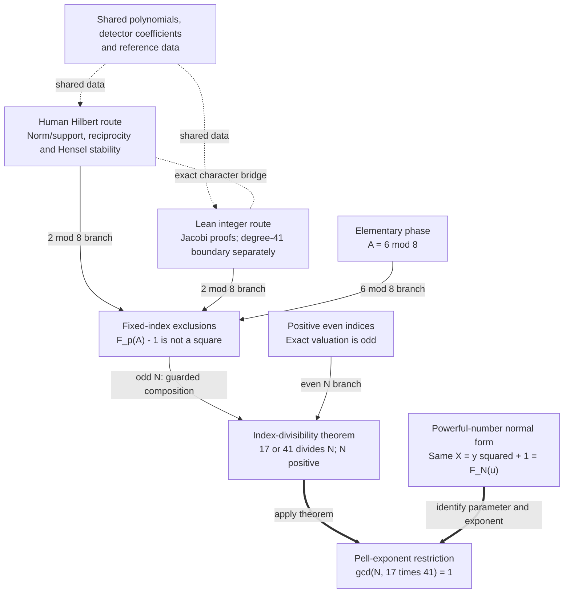

# Paper I: conceptual proof map

Read this after the [illustrated explanation](manuscript/explanation/paper_1_explained_illustrated.html)
([Markdown prose](manuscript/explanation/paper_1_explained.md)) to see how the
proof fits together. The [Hilbert–Jacobi crosswalk](hilbert-jacobi-crosswalk.md)
then supplies the exact correspondence between its two arithmetic routes.
This map follows the [v1.0.1 article](manuscript/revision/paper_1.md);
the guide and formal/arithmetic evidence retain their v1.0.0 identities.

## The target

For nonnegative integers $A,n$, define

$$
F_0(A)=1,\qquad F_1(A)=A,\qquad
F_{n+2}(A)=2AF_{n+1}(A)+F_n(A).
$$

**Theorem 1.1:** if $A\equiv2\pmod4$, $N>0$, and $17\mid N$ or
$41\mid N$, then $F_N(A)-1$ is not an integer square. Independently,
Theorem 1.3 excludes every positive even index in this parameter class.
These are uniform theorems, not conclusions drawn from a bounded search.

## The dependency map

Throughout the diagram, $A\ge0$ and $A\equiv2\pmod4$; fixed indices are
$p\in\{17,41\}$. Ordinary arrows show proof branches or theorem assembly.
Dotted connections identify shared data or mathematical correspondence;
they do not make the human Hilbert proof a dependency checked by Lean.
Thick arrows mark application to the same powerful-number candidate.

The two hard-phase routes each establish the required exclusion. Their
shared data and character bridge do not provide independent certificate
provenance. The following paragraphs give the map without relying on the diagram.

## First separate the elementary cases

For every positive even $N$,

$$
v_2(F_N(A)-1)=2v_2(N)+1.
$$

A square has even prime valuations, so this odd valuation excludes it
without any $17/41$ divisibility assumption. At the fixed odd indices,
$A\equiv6\pmod8$ gives $F_p(A)-1\equiv5\pmod8$, also impossible.
The remaining fixed-index phase is $A\equiv2\pmod8$. Its shifted values
are squares in $\mathbb Z_2$; congruences modulo higher powers of two alone
cannot remove them. See article §§2 and 5.1 and explanation §§5–6.

## The hard phase: a sign that cannot coexist with a square

Put $x=2A$, $g_p(T)=D_p(T,-1)-2$, and let $\theta_p$ be its specified
root. Here $D_p(2A,-1)=2F_p(A)$. The hypothetical equation
$F_p(A)-1=y^2$ becomes

$$
g_p(x)=2y^2,\qquad
\delta_x=\frac{x-\theta_p}{\theta_p},\qquad
\operatorname{Norm}(\delta_x)=y^2.
$$

The human proof needs three linked steps:

1. **Concentrate the support before transferring parity.** The proved
   identity $\mathcal O_{L_p}=\mathbb Z[\theta_p]$ identifies one supporting
   degree-one prime above each odd rational prime dividing the norm.
   Only then does the square norm force every odd-place valuation to be even.
2. **Choose a detector with the required character.** The explicit
   $b_p=\theta_pU_p(\theta_p)$ is a unit at odd places. Under the square
   hypothesis, its Hilbert pairing with $\delta_x$ is therefore $+1$ at
   every odd place. Positivity gives $+1$ at the real place; complex places
   contribute $+1$. Detector unitness alone does not establish its negative
   dyadic character.
3. **Transport the reference sign to every parameter.** The reference
   $x=4$ has dyadic product $-1$. Since $x\equiv4\pmod{16}$, the strict
   Hensel inequality $4e-d>2e$ makes $\delta_x/\delta_4$ a square at each
   dyadic place. The same product remains $-1$ throughout the progression.

Thus a hypothetical solution would have total Hilbert product $-1$,
contradicting reciprocity's product $+1$. Odd-place neutrality is conditional
on that hypothetical square; it does not assert local solubility everywhere.
The reference need not itself be a solution. Article §§3–4 and explanation
§§7–12 supply the arguments and finite premises. Exact coefficient,
maximality, unit and reference-character checks discharge those premises;
the quantified support and stability arguments supply their infinite reach.

## The same obstruction in integers

For $Q=F_p(A)-1>0$ in the hard phase, article Proposition 7.1 proves

$$
J(U_p(2A),Q)=-1,
$$

with positive odd denominator and coprime arguments, **without assuming
$Q$ is a square**. The crosswalk identifies this Jacobi symbol with the
odd finite Hilbert product. A square denominator would give $+1$.

Lean reaches the exclusions through exact polynomial/Jacobi transfer proofs.
It does not formalise the number-field Hilbert argument. For degree 41 the
main chain uses the oriented numerator $-U_{41}(2A)$ on $A=8j+10$;
$A=2$ is handled separately modulo $23$. The public exclusion includes both
branches, while the article's all-parameter identity is not literally one
public Lean declaration. See the crosswalk and [proof record](PROOF_RECORD.md).

## From two indices to infinitely many

The hard and elementary phases together exclude the fixed indices for all
$A\equiv2\pmod4$. For odd $N=pm$, set $B=F_m(A)$. The **odd inner index**
$m$ gives

$$
F_N(A)=F_p(B),\qquad B\equiv2\pmod4.
$$

Apply the fixed theorem to $B$; any modulo-eight split belongs to $B$,
not the original parameter alone. Positive even $N$ use the independent
valuation branch. This proves Theorem 1.1. Article §5 and explanation §14
explain why composition requires its parity guard.

## Return to exactly the same candidate

Suppose $X\ge2$, $X-1=y^2$, and $X^2+1$ is powerful. Article §6 proves
the unique decomposition $X^2+1=K^3V^2$ with squarefree $K$ and the
negative-Pell representation

$$
X+KV\sqrt K=(u+v\sqrt K)^N,\qquad X=y^2+1=F_N(u).
$$

The generator is the least unit greater than one in $\mathbb Z[\sqrt K]$;
$u\equiv2\pmod4$ and $N$ is positive and odd. Applying Theorem 1.1 gives
$\gcd(N,17\cdot41)=1$. The rank calculation additionally proves

$$
R=\frac K{\gcd(K,v)},\qquad N=RE.
$$

Either $17$ or $41$ dividing either $R$ or $E$ would divide the same full
exponent $N$ and is excluded. The v1.0.1 corollary explicitly includes
$17\mid R$ alongside the three consequences named in the frozen guide.
A prime dividing $K$ need not divide $R$ or $E$.

These are necessary restrictions. Avoiding them does not construct a
candidate, and an actual powerful triple also requires $X^2-1$ powerful.
The map neither closes the remaining exponent families nor solves Erdős 364.

## Follow a step into its source

| To inspect | Read next |
| --- | --- |
| The conceptual narrative and examples | [Illustrated explanation](manuscript/explanation/paper_1_explained_illustrated.html), §§5–15. |
| Exact Hilbert/Jacobi correspondence and degree-41 conventions | [Hilbert–Jacobi crosswalk](hilbert-jacobi-crosswalk.md). |
| Theorem statements and current Pell application | [Current article](manuscript/revision/paper_1.md), §§1–7; [correction note](manuscript/revision/README.md). |
| Human proof, finite inputs and Lean coverage | [Proof record](PROOF_RECORD.md) and [theorem–formal crosswalk](theorem-formal-crosswalk.md). |

This is an explanatory map of existing results. It reports no new proof,
certificate replay, Lean build or mathematical acceptance.
